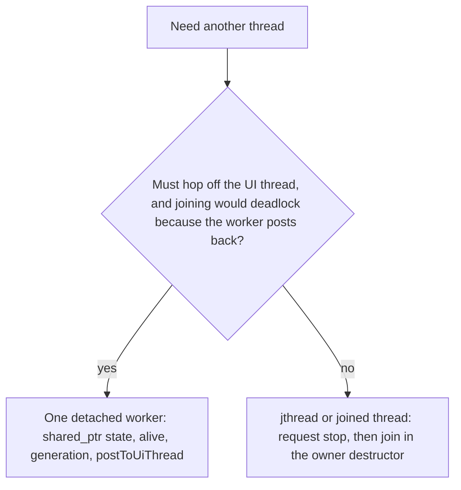

# C++ Code Style Security

Apply whenever you add or change ownership, resources, threads, shared
state, database handles, UI-thread hops, filesystem paths, child
processes, or sanitizer CI. Readability lives in `cpp-code-style`. CMake
and the CI skeleton live in `cpp-project-setup`. Tests live in
`cpp-unit-testing`. Durable file replace lives in `cpp-json-files`. Point
at those skills; do not restate them.

Do not re-scaffold CMake, CI, or the package tree. Add a sanitizer job
only when workflows already exist. Do not name a toolkit or a database
driver as the required API; the rules below are independent of both.

```
Safety progress (copy into the task):
- [ ] Composition root owns with unique_ptr; context holds references;
      members declared deps-first
- [ ] No owning raw new/delete; C handles use a unique_ptr deleter
- [ ] string_view / span not stored or captured by a thread; driver-lent
      bytes copied out before the next step
- [ ] UI hop: one in-flight detached worker, shared_ptr state, alive +
      generation, post to the UI thread, catch inside the worker
- [ ] Every other thread is joinable; stop then join before the owner dies
- [ ] lock_guard / scoped_lock; no UI or callbacks under the lock
- [ ] Paths joined under one root, lexically_normal, escape rejected
- [ ] No system / popen / shell string; argv child only if required;
      runtime DLLs beside the exe on Windows
- [ ] Linux ASan+UBSan test job exists when workflows exist
```

No commit, push, or branch switch unless the user explicitly asked.

# Ownership

The composition root owns every long-lived service with
`std::unique_ptr`. The context object holds **references** into those
owned objects. Declare a member that another member depends on **first**
so destruction runs in reverse (dependents die before their deps).

Do not construct services on the stack inside startup and then hand them
out. They must outlive the UI.

Do not use owning raw `new` / `delete`. Toolkit child widgets and
handler registration follow the toolkit's lifetime rules; if the toolkit
takes ownership of a heap object, do not also wrap it in `unique_ptr`.
That is toolkit ownership, not a license for `delete` in project code.

# Resources that need an explicit release

A connection, statement, cursor, library heap buffer, file descriptor, or
any other handle whose API requires an explicit close, finalize, or free
is owned by `std::unique_ptr` (or a one-purpose guard) whose **deleter is
the only release call**. Early return and exceptions both run the
deleter. Do not sprinkle the release on each return path.

```cpp
struct StatementDeleter {
    void operator()(Statement* s) const noexcept {
        if (s != nullptr) {
            statementClose(s);
        }
    }
};

using StatementHandle = std::unique_ptr<Statement, StatementDeleter>;
```

A prepare that fails must leave a null unique_ptr so the deleter is a
no-op. Copy bytes the driver lends for the current row into an owning
`std::string` (or a domain field) **before** the next step, reset, or
close. Those pointers are invalid after that.

# Non-owning views

`std::string_view` and `std::span` are not stored in members and are not
captured by a thread. Copy into `std::string` / `std::vector` first. A
view parameter is fine for a synchronous callee that does not keep it.

# Threads

Two cases only.



## UI-thread hop

Use this **only** when work must leave the thread that owns the UI, and
joining that worker on the UI thread would deadlock because the worker
posts a completion callable that the UI thread must run.

At most **one** in-flight worker per UI action. A newer request bumps a
generation counter and does **not** start a second thread. Either the
running worker takes the latest request, or the completion path starts
the next one after the current post is handled.

Shared state is a `std::shared_ptr` with `std::atomic<bool> alive`
(cleared in the UI object's destructor, panel pointer nulled) and
`std::atomic<unsigned> currentGen`. Inputs are copied by value into the
thread. The worker does not touch UI objects or UI-only services. It
posts a callable onto the thread that owns the UI. That callable checks
`alive` and `currentGen` before use.

Wrap the worker body in `try` / `catch (...)`. An exception must not
leave the thread (`std::terminate`).

```cpp
struct WorkerState {
    std::atomic<bool>     alive{true};
    std::atomic<unsigned> currentGen{0};
    std::atomic<bool>     busy{false};
    Panel*                panel{nullptr};
    std::mutex            requestMutex;
    std::optional<std::string> pending;
};

// destructor of the UI object:
state_->alive.store(false);
state_->panel = nullptr;

void Panel::requestWork(std::string_view input) {
    state_->currentGen.fetch_add(1);
    {
        std::lock_guard<std::mutex> lock(state_->requestMutex);
        state_->pending = std::string(input);
    }
    if (state_->busy.exchange(true)) {
        return;
    }
    startWorker();
}

void Panel::startWorker() {
    auto state = state_;
    std::thread([state]() {
        for (;;) {
            std::string request;
            unsigned gen = 0;
            {
                std::lock_guard<std::mutex> lock(state->requestMutex);
                if (!state->pending) {
                    state->busy.store(false);
                    return;
                }
                request = std::move(*state->pending);
                state->pending.reset();
                gen = state->currentGen.load();
            }
            std::string result;
            try {
                result = runOffUiThread(request);
            } catch (...) {
                result.clear();
            }
            postToUiThread([state, gen, result = std::move(result)]() {
                if (!state->alive.load()) return;
                if (state->currentGen.load() != gen) return;
                if (state->panel == nullptr) return;
                state->panel->applyResult(result);
            });
        }
    }).detach();
}
```

`postToUiThread` is whatever the toolkit uses to enqueue work on the
thread that owns the widgets. Do not call widget methods from the worker.

If the owner can join without deadlock (no post back to the joining
thread), do **not** detach: use the joinable case below.

## Every other thread

`std::jthread`, or a `std::thread` that is joined. Signal stop, then join
in the owner's destructor **before** members the worker uses are
destroyed. `std::jthread` joins on destruction; still request stop first
if the work loops. No `detach`.

# Mutexes

`std::lock_guard` or `std::scoped_lock`. One mutex per object the driver
or library says is not thread-safe (database connection, HTTP session,
shared cache). Do not call UI code, do not post to the UI thread, and do
not invoke user callbacks while the lock is held.

An object used on one thread only stays on that thread. Adding a mutex
does not make UI calls from a worker legal.

# Paths

Each store has **one** root (data directory, cache directory, and so on).
Join user or record path fragments under that root, run
`lexically_normal()`, then reject a result that is absolute outside the
normalized root or whose relative form still begins with `..`.

```cpp
[[nodiscard]] bool confinedTo(const std::filesystem::path& root,
                              const std::filesystem::path& relative) {
    if (relative.empty() || relative.is_absolute()) {
        return false;
    }
    const auto base = root.lexically_normal();
    const auto joined = (base / relative).lexically_normal();
    const auto baseStr = base.generic_string();
    const auto joinedStr = joined.generic_string();
    if (joinedStr == baseStr) {
        return true;
    }
    const auto prefix = baseStr.back() == '/' ? baseStr : baseStr + '/';
    return joinedStr.size() > prefix.size() &&
           joinedStr.compare(0, prefix.size(), prefix) == 0;
}
```

Do not pass unsanitized user text to `std::filesystem` operations that
can walk out of the store.

# Processes

Do not call `std::system`, `popen`, `_popen`, or any execute API that
takes a shell string. A child process is allowed only when the work
cannot be done in-process. Pass an argument vector. Do not look up an
executable on `PATH` from user input; use a known absolute path.

On Windows, POST_BUILD copies the MinGW runtime DLLs (`libstdc++`,
`libgcc_s`, `libwinpthread` as needed) next to the executable so `PATH`
cannot supply a mismatched runtime.

# Sanitizers

When `.github/workflows` already exist, add a **Linux Clang** job. Do not
replace the Release job from `cpp-project-setup`. Leave the Windows CI
job unsanitized.

Configure a separate build directory, Debug, tests on:

- `-fsanitize=address,undefined`
- `-fno-omit-frame-pointer`
- `-fno-sanitize-recover=undefined`
- the same flags on the linker
- `ASAN_OPTIONS=halt_on_error=1` and `UBSAN_OPTIONS=halt_on_error=1`

Run `ctest` in that directory. A sanitizer hit fails the job.

# Examples

## C handle: deleter, not paired calls

**Before** — release on the success path only; a throw leaks:

```cpp
Statement* stmt = nullptr;
if (statementPrepare(db, sql, &stmt) != 0) {
    return Result<Row>::err("prepare failed");
}
bindText(stmt, 1, name);
if (statementStep(stmt) != kDone) {
    statementClose(stmt);
    return Result<Row>::err("step failed");
}
Row row = readRow(stmt);
statementClose(stmt);
return Result<Row>::ok(std::move(row));
```

**After** — the unique_ptr is the only closer:

```cpp
Statement* raw = nullptr;
if (statementPrepare(db, sql, &raw) != 0) {
    return Result<Row>::err("prepare failed");
}
StatementHandle stmt(raw);
bindText(stmt.get(), 1, name);
if (statementStep(stmt.get()) != kDone) {
    return Result<Row>::err("step failed");
}
Row row = readRow(stmt.get());
return Result<Row>::ok(std::move(row));
```

## Composition root order

**Before** — dependent declared first; destructor closes the connection
while a repository still holds it:

```cpp
std::unique_ptr<Repository> repo_;
std::unique_ptr<Database>   db_;
```

**After** — deps first:

```cpp
std::unique_ptr<Database>   db_;
std::unique_ptr<Repository> repo_;
```

The context holds `Database&` and `Repository&`, not owning pointers.

## View captured by a thread

**Before** — the view dangles when the caller's string dies:

```cpp
std::thread([name = query.name]() {  // name is string_view
    fetch(name);
}).detach();
```

**After** — copy, then hop:

```cpp
std::string owned(query.name);
std::thread([owned = std::move(owned)]() {
    fetch(owned);
}).detach();
```

Still subject to the one-in-flight UI-hop rules above. Prefer a joinable
thread when a UI post-back is not involved.
