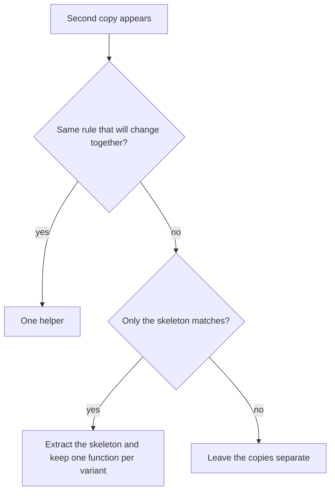

# C++ Code Style

Apply whenever you add or change C++ functions, methods, classes, or
helpers. Whitespace and `.clang-format` live in `cpp-project-setup`. Header
`/** */` and in-body comments live in `cpp-documentation`. Point at those
skills; do not restate them.

Do not re-scaffold CMake, CI, or the package tree. Do not split an
**untouched** large function in the same change. When an edit adds a branch
to a function that already breaks the caps, extract instead of growing it.

```
Style progress (copy into the task):
- [ ] Complexity ≤ 10, nesting ≤ 3, body about one screen (~50 lines),
      or the cohesive-dispatch exception with thin branches
- [ ] Guard clauses first; main path flat
- [ ] One abstraction level per function
- [ ] Same-rule DRY; helper in the right place; no one-caller utility
- [ ] Signatures: unclear or multiple `bool`s, long lists, magic values
- [ ] Names, class order, header shape
```

No commit, push, or branch switch unless the user explicitly asked.

# Complexity

Count starts at **1**. Add **1** for each `if`, `else if`, `for`, `while`,
`case`, `catch`, `&&`, `||`, and `?:`. Nesting is the deepest brace of
control flow, not of initializer lists.

Soft caps for new and edited functions:

| Cap | Limit |
|---|---|
| Cyclomatic complexity | ≤ 10 |
| Nesting | ≤ 3 |
| Body | about one screen (~50 lines) |

Exceed a cap only for **one cohesive dispatch** whose branches stay thin:
a closed `switch` on a known set of cases, a window-tree walk, or a
template base that holds shared machinery. Split any function that **mixes
steps** (validate, then parse, then I/O, then UI) even when the count is
under the cap.

A type may be longer than one function. The caps apply to each function,
not to the file.

# Guard clauses

Handle the invalid, empty, and failed case first, then the main path.
Propagate `Result` with `if (!r) return ...`. Do not nest the success path
inside `if (r)`.

# One abstraction level

An orchestrator only calls named steps and returns. A step does **one** of:
validate, parse, I/O, or UI update. Do not mix those in one body.

# Size by layer

Core functions follow the caps. A UI type may be longer if `buildLayout`,
`populate`, and the handlers are **separate functions**. The constructor
wires them; it does not contain them.

# Same-rule DRY

A second copy of the **same rule** (behavior that will change together)
becomes **one helper**. Similar code with **different rules** stays
separate; share only the skeleton. Do not add a utility for a single
caller.



Keep an explicit function per variant when the rules differ. Do not fold
those variants into one function full of `if (kind == ...)` unless the
rule really is shared.

# Where the helper lives

| Callers | Place |
|---|---|
| One `.cpp` | Anonymous namespace in that file |
| Several `.cpp` files in one library | Internal header under `src/`, not the public include tree, in a `*_detail` namespace |
| Another target must call it | Public header in that module's `util/` (or the type that owns the rule) |

Use free functions in a named namespace. Do not invent a grab-bag `Utils`
class.

# Signatures

- More than one `bool` parameter, or a `bool` whose meaning is unclear at
  the call site, becomes an `enum class`.
- More than four parameters, or a call the reader must count through,
  becomes a small parameter struct. A persistence boundary that mirrors
  stored columns may keep the long list.
- Magic numbers and stringly modes become `constexpr` or `enum class`.

# Names and types

| Kind | Form |
|---|---|
| Function, method | `camelCase` |
| Type, enum | `PascalCase` |
| Data member | trailing underscore (`name_`) |
| Interface | `I` prefix, virtual destructor |
| Adapter that must not be derived | `final` |
| Enumerator | `PascalCase` |

Class sections in this order: public, then protected, then private.

# Headers

`#pragma once`. One primary type per header. In a `.cpp`: matching header,
other project headers, then angle-bracket headers. Forward-declare in a
header when only a pointer or reference is used.

# Examples

## Guards and a shared helper

**Before** — nested checks, duplicated fold:

```cpp
bool nameMatches(std::string_view name, std::string_view needle) {
    if (!needle.empty()) {
        const auto foldedNeedle = asciiLower(needle);
        if (!name.empty()) {
            return asciiLower(name).find(foldedNeedle) != std::string::npos;
        }
        return false;
    }
    return true;
}

bool skuMatches(std::string_view sku, std::string_view needle) {
    if (!needle.empty()) {
        const auto foldedNeedle = asciiLower(needle);
        if (!sku.empty()) {
            return asciiLower(sku).find(foldedNeedle) != std::string::npos;
        }
        return false;
    }
    return true;
}
```

**After** — empty needle first, one helper, two call sites:

```cpp
namespace {

bool containsIgnoreCase(std::string_view haystack, std::string_view needle) {
    if (needle.empty()) {
        return true;
    }
    if (haystack.empty()) {
        return false;
    }
    return asciiLower(haystack).find(asciiLower(needle)) != std::string::npos;
}

}  // namespace

bool nameMatches(std::string_view name, std::string_view needle) {
    return containsIgnoreCase(name, needle);
}

bool skuMatches(std::string_view sku, std::string_view needle) {
    return containsIgnoreCase(sku, needle);
}
```

## Shared skeleton, different rules

`Widget` and `Gadget` look similar. Their match fields are **not** the
same rule. Share the empty-needle short-circuit; keep one function per
variant.

```cpp
template <typename T, typename Match>
bool matchesFilter(const T& item, std::string_view needle, Match match) {
    if (needle.empty()) {
        return true;
    }
    return match(item, needle);
}

bool matchesWidgetFilter(const Widget& w, std::string_view needle) {
    return matchesFilter(w, needle, [](const Widget& x, std::string_view n) {
        return containsIgnoreCase(x.name, n) || containsIgnoreCase(x.sku, n);
    });
}

bool matchesGadgetFilter(const Gadget& g, std::string_view needle) {
    return matchesFilter(g, needle, [](const Gadget& x, std::string_view n) {
        return containsIgnoreCase(x.title, n) || containsIgnoreCase(x.owner, n);
    });
}
```

Do **not** merge those into one function that switches on a kind tag
unless both variants will always keep the same fields.
