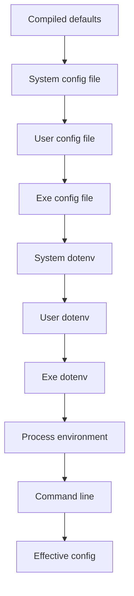

# C++ Config

Apply whenever you add or change runtime settings, `config.json`, a
properties file, `.env`, `getenv`, environment variables, CLI flags that
override settings, a typed config struct, or config documentation.

Do not invent a second file format. Do not add a second JSON library; use
the one the repository already uses. Do not search the current working
directory. Do not watch the file after load. Compile-time build options are
not a runtime layer.

```
Config progress (copy into the task):
- [ ] Typed struct; every field lists type, default or required, file key,
      env name, flag, secret-or-not
- [ ] Cascade: defaults < system file < user file < exe file < system .env
      < user .env < exe .env < process env < CLI; nested overlay
- [ ] Paths: OS exe resolve (or the GUI toolkit's standard paths); system,
      user, exe dirs; never cwd
- [ ] Missing file skipped; if no config file exists, create defaults at
      the write location; do not create .env
- [ ] Unknown key in any layer fails (name the key and the layer);
      process env: only the app prefix participates
- [ ] Secrets only from .env or process env; file or CLI secret fails;
      logs show (set)/(missing), never the value
- [ ] Atomic write of the file layer only; exe dir if writable, else user
      dir; never the system dir
- [ ] Migrate retired keys/values, then rewrite that file if it changed
- [ ] Load once; log every effective value and winning layer
- [ ] Docs: struct comment, config.example + .env.example, gitignore,
      README catalog
- [ ] Tests through an in-memory filesystem (list in Tests)
```

No commit, push, or branch switch unless the user explicitly asked.

# Precedence

Lowest to highest, **per key**. Nested objects overlay field by field; a
higher layer does not replace a whole object unless it sets every field.



Every `.env` beats every config file. A system `.env` therefore beats an
exe-directory `config.json`.

Keep a layer tag on each field (`default`, `system-file`, `user-file`,
`exe-file`, `system-dotenv`, `user-dotenv`, `exe-dotenv`, `process-env`,
`cli`) so save, the settings UI, and the effective log know who won.

# Directories

Resolve the executable path from the OS, not from `argv[0]` and not from
the current working directory:

- Linux: `readlink` of `/proc/self/exe`
- Windows: `GetModuleFileNameW`
- macOS: `_NSGetExecutablePath`

If the app already has a GUI toolkit, that toolkit's standard executable
path is acceptable. The config file is `parent(exe) / "config.json"`.

| Layer | Windows | POSIX |
|---|---|---|
| System | `%ProgramData%/<AppName>/` | `/etc/<app-name>/` |
| User | `%APPDATA%/<AppName>/` | `${XDG_CONFIG_HOME:-$HOME/.config}/<app-name>/` |
| Exe | directory of the executable | directory of the executable |

`<AppName>` is the display name on Windows. `<app-name>` is lowercase with
hyphens on POSIX. Substitute the real names; do not leave the tokens in
the project.

Search **only** those three directories. Do not search cwd, `$HOME`
directly, or extra vendor folders.

# File format

Default: JSON (`config.json`), 2-space pretty print on write. Keys match
the declared file key on each field (usually camelCase).

Use a properties file (`config.properties`: `key=value`, `#` comments,
dotted keys for nested fields such as `window.height=900`) **only** when
the repository already uses properties. One format per app. Do not add
JSON and properties side by side.

`.env` is always a cascade layer, independent of the file format:

```
# comment
APP_THEME=Dark
APP_API_TOKEN="quoted value"
```

`KEY=VALUE`. Optional matching quotes. `#` to end of line. Strip a leading
`export `. No interpolation, no `$VAR` expansion. Duplicate keys in one
file: last wins, then the next layer overlays.

# Schema

One typed struct. Not a string map. Each field declares, next to the
struct (comment or a small spec table in the same header):

| Attribute | Rule |
|---|---|
| Type | `string`, bool, signed integer, or enum class |
| Default | Compiled default, **or** required with no default |
| File key | Exact JSON key or dotted properties key. No guessing. |
| Env name | Exact `APP_DATA_STORAGE` form. No camelCase-to-snake guessing. |
| Flag | Exact `--data-storage`. Secrets have **no** flag. |
| Secret | Marked or not. See Secrets. |

```cpp
// Configuration: runtime settings.
// Cascade: defaults < system file < user file < exe file <
//          system .env < user .env < exe .env < process env < CLI.
//
//   dataStorage  string  default "<exe>/data"  env APP_DATA_STORAGE  flag --data-storage
//   theme        enum    default Light         env APP_THEME         flag --theme
//   apiToken     string  secret, required      env APP_API_TOKEN     (no flag)
//
//   { "dataStorage": "/abs/path", "theme": "Light" }
struct Configuration {
    std::string dataStorage;
    Theme       theme{Theme::Light};
    std::string apiToken;
};
```

Text layers (properties, `.env`, process env, CLI) parse:

- bool: only `true` or `false`
- integer: full-string parse, no leftover characters, no overflow
- enum: exact declared spelling (`Light`, `Dark`)
- string: as written, after quote strip

JSON uses the repository's existing library. Required file keys use
strict get (`at`). Optional keys use a defaulting get. Persist paths with
`std::filesystem::path::generic_string()` (forward slashes on Windows).

A required field still unset after the last layer fails startup: name the
field.

# Load

One service. `initialize()` once at startup. No reload API. External edits
take effect on the next process start.

1. Resolve the three directories.
2. Start from compiled defaults; tag every field `default`.
3. For each config file in order (system, user, exe): if missing, skip; if
   present, read, parse, **migrate**, reject unknown keys, overlay by
   field, tag winners.
4. Repeat for `.env` in the same directory order.
5. Walk the process environment. Ignore names without the app prefix.
   Prefix + unknown field fails. Overlay matches; tag `process-env`.
6. Parse CLI. Overlay declared flags; tag `cli`.
7. Fail if a required field is still at "unset".
8. Fail if a secret was set by a config file or by the CLI.
9. If **no** config file existed on disk, write compiled defaults (not
   env/CLI values) to the write location. Do not create `.env`.
10. If migration rewrote keys in a file, save that file in the current
    schema (atomic).
11. Log the effective snapshot. Return the typed struct.

Catch parse exceptions inside the loader and return an error. Do not throw
across the service boundary.

# Unknown keys

Unknown keys fail startup in **every** layer. Do not keep them. Do not
write them back. The error names the key (dotted for nested JSON) and the
layer (`exe-file`, `user-dotenv`, `process-env`, `cli`, …).

Migrate retired keys **before** this check so a renamed field is not
reported as unknown.

Process environment is special:

- Names **without** the app prefix are ignored (the rest of the process
  environment is not config).
- A name **with** the prefix that matches no field fails.

CLI: `--help` and `--version` are not config. Every other `--*` flag that
is not a declared field flag fails. Non-flag positional arguments are not
config; leave them to the app.

# Secrets

A field marked secret:

- May be set only by a `.env` file or by the process environment.
- Presence in a config file or as a CLI flag fails startup.
- Has no `--flag`.
- Must not appear in `config.example.json`. `.env.example` may list the
  env name with an empty or placeholder value, never a real token.

When logging or printing config, a secret is `(set)` or `(missing)` plus
the winning layer. Never the value.

# Save

User edits (settings UI or an explicit store) write **the file layer
only**. Values whose winning layer is `.env`, process env, or CLI stay out
of the file. After a save, re-apply env and CLI on top of the new file
layer so effective values stay correct.

Write location:

1. Executable directory if a file can be created there.
2. Otherwise the user directory (create it if needed).
3. Never the system directory.
4. If the user directory is also unwritable, fail the save; do not fall
   back to cwd.

Atomic replace: write `config.json.tmp` (or `.properties.tmp`) in the
**same** directory, then replace the target.

- POSIX: `rename(2)` over the destination.
- Windows: `std::filesystem::rename` does **not** replace an existing
  file; use `ReplaceFileW` (or an equivalent replace-rename). Do not
  `remove` then `rename` (a crash loses the file).

Do not write `.env` from the app unless the user is explicitly editing
dotenv through a dedicated, documented path. The settings UI writes the
config file, not `.env`.

# Migration

Keep a documented map of retired file keys, env names, flags, and enum
values next to the struct. On load, apply it to that layer, then run the
unknown-key check.

If a file's contents changed under migration, write the **current** schema
back to that same path (atomic). Do not write env/CLI values into it. Do
not write a file that was not migrated.

# Effective log

After a successful load, log **every** field through the application's
logger, or stderr if the app has none. One line per field: name, value or
redaction, winning layer.

```
config dataStorage=/home/user/data layer=user-file
config theme=Dark layer=process-env
config apiToken=(set) layer=exe-dotenv
```

Do not log argv, the raw file text, or secret values.

# Errors

Malformed JSON, a properties/`.env` syntax error, a type mismatch, an
unknown key, a secret in a forbidden layer, or a missing required field
fails startup. Malformed files are **not** skipped.

Surface the error string in the GUI toolkit's error dialog, or on stderr
in a headless process, and abort startup. Same pattern for a failed save
from the settings UI (dialog or stderr; do not abort the process).

# Documentation

Ship all of the following in the app repository:

1. Schema comment on the struct (example JSON plus the field table).
2. Committed `config.example.json` (and `config.example.properties` only
   if that is the app format). Placeholders, no machine-local paths that
   look real, no secrets.
3. Committed `.env.example` listing every env name, secrets empty.
4. Gitignore `config.json`, `config.properties`, and `.env`.
5. App README section:

```markdown
## Configuration

Precedence (low to high): compiled defaults, then `config.json` in the
system directory, the user directory, and the executable directory, then
`.env` in that same directory order, then process environment variables,
then command-line flags. Nested objects overlay per field.

| Directory | Windows | POSIX |
|---|---|---|
| System | `%ProgramData%/<AppName>/` | `/etc/<app-name>/` |
| User | `%APPDATA%/<AppName>/` | `$XDG_CONFIG_HOME` or `~/.config/<app-name>/` |
| Exe | directory of the executable | directory of the executable |

A missing file is skipped. If no config file exists, the app creates one
from defaults next to the executable, or in the user directory when the
executable directory is not writable. `.env` is never auto-created.

| Key | Type | Default | Required | Env | Flag | Description |
|---|---|---|---|---|---|---|
| dataStorage | string | `<exe>/data` | no | APP_DATA_STORAGE | --data-storage | Directory for application data |
| theme | enum | Light | no | APP_THEME | --theme | `Light` or `Dark` |
| apiToken | string | (none) | yes | APP_API_TOKEN | (none, secret) | API token; `.env` or environment only |
```

Substitute real keys. Keep the catalog in the README in sync with the
struct when a field is added.

# Tests

Use an in-memory filesystem fake. Do not touch the host disk, real
environment, or the user's home. Inject directory paths, env snapshots,
and argv.

Cover at least:

- Missing files skipped; no file at all creates defaults at the write
  location
- System < user < exe overlay, including nested field overlay
- Every `.env` beats every config file
- Process env beats `.env`; CLI beats process env
- Unknown key fails; names key and layer
- Prefixed unknown env var fails; unprefixed env var ignored
- Malformed file fails (not skipped)
- Type mismatch and unknown enum fail
- Required field missing after all layers fails
- Secret in a config file or CLI fails; secret from `.env` or process env
  succeeds
- `store` writes the file layer only (env/CLI values absent from the file)
- Unwritable exe directory writes the user directory; system never written
- Retired key/value migrates, then the file is current-schema
- Effective log redacts secrets as `(set)` / `(missing)`
- Atomic replace: destination exists, content is the new snapshot

# GUI and storage

A settings UI reads the **effective** struct. It writes through the same
service (`store` of the file layer). When a higher layer still overrides a
saved field, show the winning layer so the user can see why the control
did not stick.

A path field (`dataStorage` or similar) is handed to storage. The config
loader does not open a database, create tables, or read collections.

Build-time version strings and toolchain flags stay in the build. They are
not merged into this cascade.

# Examples

## Nested overlay

System file:

```json
{ "window": { "width": 800, "height": 600 }, "theme": "Light" }
```

User file:

```json
{ "window": { "height": 900 } }
```

Process env `APP_THEME=Dark`.

Effective: `window.width=800` (system-file), `window.height=900`
(user-file), `theme=Dark` (process-env).

## Do not copy env into the file

Effective `theme` is `Dark` from `APP_THEME`. User saves a new
`dataStorage` in settings. The file becomes:

```json
{
  "dataStorage": "/home/user/data",
  "theme": "Light"
}
```

`theme` in the file is still the file-layer value. Effective `theme`
remains `Dark` until the environment changes.

## Unknown key

```json
{ "dataStorage": "/data", "typoTheme": "Dark" }
```

Startup fails: `unknown key 'typoTheme' in layer exe-file`.
