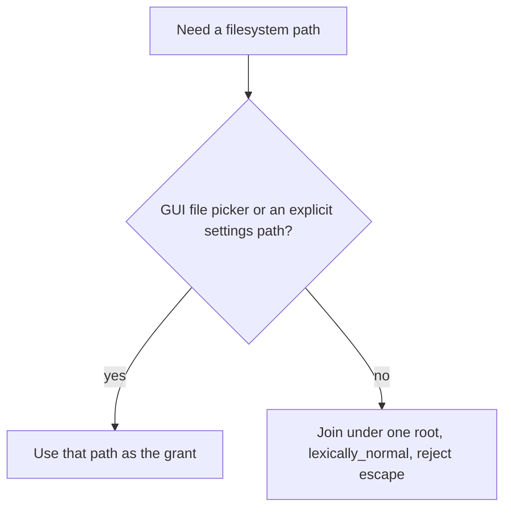

# C++ Data Security

Apply whenever you add or change secrets, credentials, config, user-data
paths, caches, filesystem joins, database statements, import or export of
untrusted files, or outbound HTTP. This skill is **secrets, data classes,
and access**. Memory ownership, threads, and sanitizers are out of scope.

Do not re-scaffold CMake, CI, or the package tree. Do not encrypt ordinary
user records: they must not contain secrets.

```
Security progress (copy into the task):
- [ ] No secret in source, logs, errors, URLs, or user-data files
- [ ] Secret from env or gitignored file; missing or empty is a hard fail
- [ ] CI secrets from the platform store only
- [ ] Deps pinned by tag or content hash; license checked
- [ ] User records in a per-user directory; durable replace; schema documented
- [ ] Config beside the install only if it holds no secrets and needs no elevation
- [ ] Derived cache is a separate root; hash filenames need an exact-key sidecar
- [ ] No elevation; no symlink that leaves the chosen root
- [ ] App-built paths confined; GUI picker / settings path is the user's grant
- [ ] External SQL values bound; import 32 MiB, known entries in memory
- [ ] Export escapes markup; HTTPS except loopback; no secret on a host redirect
```

No commit, push, or branch switch unless the user explicitly asked.

# Secrets

Never embed a secret in source, a header, a test fixture, or a workflow
file. Load it from the environment or from a file that is gitignored and
outside the repo. If the value is missing or empty, return an error and
do not continue. Do not invent a fallback key.

CI injects secrets from the platform secret store. Do not print them,
write them into logs, put them in `Result` error strings, or paste them
into URLs (query or userinfo). Do not persist them in a user-data file or
in config that sits next to the install.

A public, unauthenticated endpoint needs no key. Do not add a dummy
secret "for later."

# Supply chain

Pin every dependency by git tag or by URL plus content hash. Do not track
`master`, `main`, or another floating branch. Before adding a dependency,
confirm its license is compatible with this repository's license.

# Data classes

Three roots. Do not mix them.

| Class | Default location | Write | Contents |
|---|---|---|---|
| User records | Per-user directory (home or the OS user-data folder), **not** beside the executable | Durable: temp file, flush, then replace | Documented schema. No secrets. Unencrypted. |
| Config | Beside the install **only** if it holds no secrets and that directory is writable without elevation; otherwise the per-user directory | Durable replace | Paths, theme, last-used ids. No tokens. |
| Derived cache | A root **outside** the user-data directory (install-scoped cache dir, or the OS cache folder) | Best-effort; I/O failure must not break the feature | Downloaded or computed artifacts. Not part of user backups. |

When a stored file or a table changes, update the schema document in the
same change.

A non-cryptographic hash in a cache filename is allowed only when a
sidecar stores the **exact** key and a mismatch (or a missing sidecar) is
a miss. Never serve another key's bytes.

# Access

The process does not require elevation. If the install directory is not
writable without elevation, do not write config, cache, or user records
there.



A GUI file picker or an explicit settings path is the user's grant. Do
not re-root it under the default data directory.

Every **app-built** path is joined under one root. Each relative fragment
is a single filename component: reject empty, `.`, `..`, `/`, `\`, and an
absolute fragment. Then `lexically_normal()`. Reject a result that is
outside the normalized root. If the path exists, `weakly_canonical` both
root and candidate and reject a symlink (or junction) that resolves
outside that root. Do not follow it.

```cpp
[[nodiscard]] bool confinedTo(const std::filesystem::path& root,
                              const std::filesystem::path& relative) {
    if (relative.empty() || relative.is_absolute()) {
        return false;
    }
    for (const auto& part : relative) {
        const auto s = part.generic_string();
        if (s.empty() || s == "." || s == "..") {
            return false;
        }
        if (s.find_first_of("/\\") != std::string::npos) {
            return false;
        }
    }
    const auto base = root.lexically_normal();
    const auto joined = (base / relative).lexically_normal();
    std::error_code ec;
    const auto canonBase = std::filesystem::weakly_canonical(base, ec);
    if (ec) {
        return false;
    }
    const auto canonJoined = std::filesystem::weakly_canonical(joined, ec);
    if (ec) {
        return false;
    }
    const auto baseStr = canonBase.generic_string();
    const auto joinedStr = canonJoined.generic_string();
    if (joinedStr == baseStr) {
        return true;
    }
    const auto prefix = baseStr.back() == '/' ? baseStr : baseStr + '/';
    return joinedStr.size() > prefix.size() &&
           joinedStr.compare(0, prefix.size(), prefix) == 0;
}
```

# Database, import, export, HTTP

External values that reach a database (user text, file contents, network
data) are bound parameters. A statement the program builds from its own
fixed table name or from a row id it just received may concatenate that
internal value. Do not concatenate any value that originated outside the
process.

Import of an untrusted file:

- Reject a payload over **32 MiB**.
- Parse only known entry names, in memory.
- Never write a path taken from the file (archive members, markup
  `href`, or a nested relative path).

Export of user text into markup: escape `&`, `<`, `>`, `"`, and `'`. Drop
other control characters (keep tab, newline, carriage return).

Remote calls: HTTPS, except `http` to `localhost`, `127.0.0.1`, or `::1`.
Percent-encode user text in a URL (RFC 3986 unreserved set; space is
`%20`). Do not put a secret in the URL. A request that carries a secret
does not follow a redirect onto another host.

# Examples

## Hard-coded key versus environment

**Before** — the secret is in the tree and will leak into logs on failure:

```cpp
constexpr const char* kApiKey = "sk-live-example";

Result<std::string> fetch(IHttpClient& http) {
    const auto url = std::string("https://api.example/v1?key=") + kApiKey;
    auto body = http.get(url);
    if (!body) {
        return Result<std::string>::err(
            std::string("GET failed for ") + url);
    }
    return body;
}
```

**After** — missing key is a hard fail; the value is a header, never an
error string:

```cpp
Result<std::string> loadApiKey() {
    const char* key = std::getenv("APP_API_KEY");
    if (key == nullptr || key[0] == '\0') {
        return Result<std::string>::err("APP_API_KEY is not set");
    }
    return Result<std::string>::ok(std::string(key));
}

Result<std::string> fetch(IHttpClient& http) {
    auto key = loadApiKey();
    if (!key) {
        return Result<std::string>::err(key.error());
    }
    return http.get("https://api.example/v1",
                    {{"Authorization", "Bearer " + key.value()}});
}
```

Gitignore the local secret file if you use one (`secrets.json`, `.env`).
Name the variable in errors, not the value.

## App-built path versus confinement

**Before** — a record name walks out of the store:

```cpp
std::filesystem::path imagePath(const std::filesystem::path& root,
                                std::string_view name) {
    return root / std::string(name);
}
```

**After** — one component, then the check:

```cpp
Result<std::filesystem::path> imagePath(const std::filesystem::path& root,
                                        std::string_view name) {
    const std::filesystem::path relative{std::string(name)};
    if (!confinedTo(root, relative)) {
        return Result<std::filesystem::path>::err("path escapes store");
    }
    return Result<std::filesystem::path>::ok(root / relative);
}
```

A path from a GUI file picker or from the settings data-directory field
skips this join. It is already the grant.

## Cache hash without a sidecar

**Before** — a collision serves the wrong bytes:

```cpp
std::optional<std::string> load(const std::filesystem::path& cacheRoot,
                                std::string_view key) {
    return readText(cacheRoot / (hashKey(key) + ".bin"));
}
```

**After** — sidecar must match the exact key; otherwise miss:

```cpp
enum class Hit { Miss, Payload };

std::pair<Hit, std::string> load(const std::filesystem::path& cacheRoot,
                                 std::string_view key) {
    const auto hash = hashKey(key);
    auto idx = readText(cacheRoot / (hash + ".idx"));
    if (!idx || idx.value() != key) {
        return {Hit::Miss, {}};
    }
    auto body = readText(cacheRoot / (hash + ".bin"));
    if (!body) {
        return {Hit::Miss, {}};
    }
    return {Hit::Payload, std::move(body).value()};
}
```

## Export markup and import archives

**Before** — user text breaks markup; a zip member writes an arbitrary
path:

```cpp
xml += "<t>" + row.note + "</t>";

for (const auto& entry : zip.entries) {
    writeFile(outDir / entry.name, entry.bytes);
}
```

**After** — escape on the way out; known names only, in memory, size-capped:

```cpp
constexpr std::size_t kMaxImportBytes = 32 * 1024 * 1024;

xml += "<t>" + escapeMarkup(row.note) + "</t>";

if (bytes.size() > kMaxImportBytes) {
    return Result<Rows>::err("import exceeds 32 MiB");
}
for (const auto& entry : zip.entries) {
    if (entry.name != "sheet.xml") {
        continue;
    }
    return parseSheet(entry.bytes);
}
```

`escapeMarkup` replaces `&`, `<`, `>`, `"`, and `'`, and drops other
control characters.
