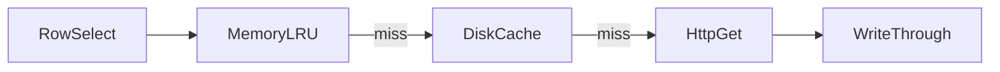

# C++ Documentation

Apply whenever you add or change C++ declarations, complex function bodies,
cross-module behavior, or the files that orient agents. Do not re-scaffold
CMake, CI, or the starter `docs/` / `AGENTS.md` tree.

Each fact lives in **one** place. The other layers point at it.

| Layer | Holds | Does not hold |
|---|---|---|
| Header `/** */` | Contract of one class, member, or function | Cross-module sequences |
| Function body `//` | Why a complex stretch of code is shaped that way | The public contract (that is in the header) |
| `docs/*.md` | A flow or data shape that crosses types or modules | Single-function behavior |
| `AGENTS.md` | Where to look, and invariants not to break | Long behavior (put that in `docs/` and leave a pointer) |

```
Doc progress (copy into the task):
- [ ] Header `/** */` if the contract changed or was missing
- [ ] In-body `//` if a complex block changed
- [ ] `docs/*.md` if a flow or data shape changed
- [ ] Owning `AGENTS.md` if the map or an invariant changed
- [ ] `docs/README.md` and `docs/AGENTS.md` if a doc file was added
```

A stale comment or page is worse than none. Update or delete it in the
**same** change as the code. When you edit a declaration that should already
have a Doxygen block and does not, add it in that change.

# API comments

Public and protected contracts go in the **header**, in a `/** */` block
immediately above the declaration. Do **not** repeat that block on the `.cpp`
definition. Do **not** add a file banner that repeats the class block. Do not
generate a Doxyfile or HTML unless the user asked.

## What to document

- Every class and class template: role, invariants, and (when not obvious)
  ownership and threading.
- Data members, enumerators, and template parameters whose meaning, unit,
  sentinel, or constraint is not obvious from the name.
- Every function and method that is not a trivial accessor, including
  important private helpers that encode a real contract.

## What to skip

- Trivial accessors (`get` / `set` that only return or assign a member, or
  `size()` / `empty()` / `data()` with no extra rule).
- Defaulted special members.
- Obvious comparison operators when the type block already states equality.
- Private one-liners that only forward to another method.

## Required tags

On each documented function or method:

- `@brief` — one sentence. Do not restate the signature.
- `@param` — one per parameter. State units, nullability, ownership, or
  sentinels when the name hides them.
- `@return` — when the function is non-void. State error shape (`Result`,
  empty, sentinel) when it is not obvious.
- `@tparam` — when there are template parameters, including constraints.

Add `@pre`, `@post`, `@throws`, or `@note` when ownership, lifetime, thread
safety, error policy (`Result` vs exception), units, or sentinels are not
obvious from the signature. **No empty tags.** Do not invent `@throws` for a
`Result`-based API that does not throw.

Class and enum blocks use `@brief` plus prose. Member comments may be a short
`/** ... */` on the preceding line, or a trailing `/**< ... */` when the
member is a one-line field.

# In-body comments

When a function or method body has complex internal logic — a multi-step
algorithm, a non-obvious branch, a hidden invariant, or an ordering that is
easy to break — add plain `//` comments at those blocks so the following
code is understandable.

- Put them in the `.cpp`, directly above the block they explain. If the body
  lives in the header (inline or template), put them there.
- Explain **why** the next code is shaped that way.
- Do not narrate every statement (`// increment i`).
- Do not restate the Doxygen contract.
- Update or delete them in the same change that changes that logic.

A short, linear function that matches its `@brief` needs no in-body comments.

# `docs/` flow pages

Add or update a markdown page when behavior spans more than one type or
module: business rules, data flow, persistence shape, or an external
sequence. One topic per file. Single-function behavior stays in the header.

Page shape:

1. Purpose (what this page is the source of truth for)
2. Participants — real types and repo paths
3. The flow
4. Data shape (keys, files, tables, on-disk layout)
5. Invariants
6. What this page does **not** cover (point elsewhere)

If the sequence has more than a few steps, include a short mermaid diagram.
Quote real paths. Do not describe unmerged work as current behavior.

List every new page in both `docs/README.md` and `docs/AGENTS.md`. When the
flow, participants, or data shape change, update that page in the same
change.

# Nested `AGENTS.md`

Root file is a **map**. Nested files are **local**. Agents follow the path
root → owning directory; they should not need to open every source file to
orient.

## Root `AGENTS.md`

- One-line purpose of the repository
- Directory map; each bullet points at that directory's `AGENTS.md`
- Architecture invariants that cross packages
- Commands
- Cross-package follow-ups (including: after adding a `docs/` file, list it
  in `docs/README.md` and `docs/AGENTS.md`)

Not a catalog of every type. Not a paste of nested files.

## Nested `AGENTS.md`

Every directory an agent will edit gets one. That file covers **that
directory only**. First line: read the root `AGENTS.md` first.

- Local file or layer pointers (types and paths that exist)
- Local conventions
- Local commands
- Local follow-ups, including which `docs/` page to update when this
  directory's seams change

More specific than the root. If an explanation is longer than a short
invariant, put it in `docs/` and leave a one-line pointer. Do not paste a
header contract into either layer.

When structure, invariants, the file list, or commands change, update the
`AGENTS.md` that owns that fact. Renaming an `AGENTS.md` updates every file
that points at it.

# Examples

## Header contract (do)

```cpp
/**
 * @brief Bounded in-memory cache of lookup payloads, evicted in LRU order.
 *
 * Not thread-safe; callers serialize access. Only successful payloads are
 * stored — misses and errors are never cached.
 */
class PreviewCache {
public:
    /**
     * @brief Store or replace the payload for @p key and mark it most recently used.
     * @param key Lookup fingerprint. Empty keys are rejected.
     * @param payload Raw bytes to keep. Moved in.
     * @return true if stored; false if @p key is empty.
     * @note Evicts the least-recently-used entry when the cache is already
     *       at capacity and @p key is new.
     */
    bool store(std::string key, std::string payload);

    std::size_t size() const noexcept;

private:
    std::size_t capacity_{128};  /**< Hard cap on entries, not bytes. */
};
```

`size()` is a trivial accessor — left uncommented.

## Header contract (do not)

```cpp
// PreviewCache caches preview bytes.
class PreviewCache {
public:
    /// Stores a payload.
    bool store(std::string key, std::string payload);

    /** @brief Number of entries. @return the size. */
    std::size_t size() const noexcept;
};
```

Plain `//` / `///` is not the required form. Do not document `size()`. Do
not write empty or tautological tags.

## In-body (do)

```cpp
bool PreviewCache::store(std::string key, std::string payload) {
    if (key.empty()) {
        return false;
    }
    // Evict before insert so a full cache never grows. A replace of an
    // existing key is size-neutral and must not evict a different entry.
    if (entries_.size() >= capacity_ && !contains(key)) {
        evictLru();
    }
    entries_.insert_or_assign(std::move(key), std::move(payload));
    return true;
}
```

No second Doxygen block on the definition.

## In-body (do not)

```cpp
bool PreviewCache::store(std::string key, std::string payload) {
    // Check if the key is empty
    if (key.empty()) {
        return false;
    }
    // Insert or assign the payload
    entries_.insert_or_assign(std::move(key), std::move(payload));
    return true;
}
```

Those comments restate the next line. The empty-key rule belongs in `@param`
/ `@return`, not here.

## `docs/` page skeleton

````markdown
# Preview lookup

Source of truth for how a preview is resolved from a row selection to bytes
on screen. Per-function contracts stay on `PreviewCache` and `PreviewService`.

## Participants

- `core/include/NS/services/PreviewService.hpp` — orchestration
- `core/include/NS/ports/IHttpClient.hpp` — GET seam
- `ui/src/SelectedPanel.cpp` — decode and paint

## Flow



## Data shape

Cache key is `(kind, name, setId, setNo)`. Persistent files live under
`<exeDir>/.cache/preview-cache/`, not under the user data directory.

## Invariants

- Transient HTTP failures are never stored.
- Editing a lookup field changes the key; no manual invalidate API.

## Out of scope

HTTP session reuse is a local convention on the `IHttpClient` adapter;
see `core/AGENTS.md`.
````

## `AGENTS.md` split (do)

Root map bullet:

```markdown
- `core/` — `PROJ_core`. Logic; no UI-toolkit headers. See `core/AGENTS.md`.
  Preview lookup order: `docs/preview-lookup.md`.
```

Nested `core/AGENTS.md` holds the local rule, not the full sequence:

```markdown
# core/AGENTS.md

`PROJ_core` — logic library. **No UI-toolkit headers.** Read the root
`AGENTS.md` first.

## Conventions

1. Transient HTTP failures are never written to `PreviewCache`.
2. After changing lookup key fields or cache tiers, update
   `docs/preview-lookup.md`.
```

Do not paste `docs/preview-lookup.md` into either `AGENTS.md`.
