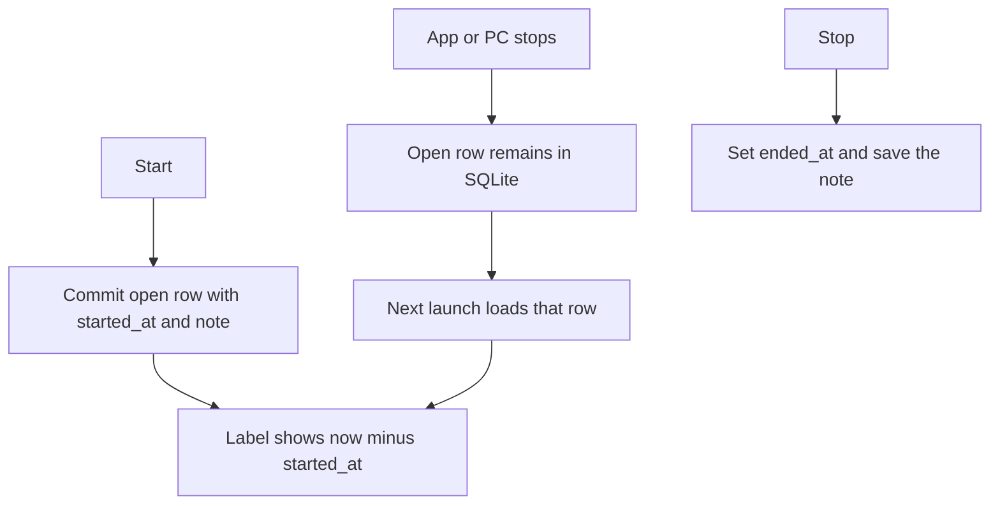

# Time tracking

Source of truth for how a timer is started, kept across shutdown, stopped,
and summarized. Per-function contracts stay on the service headers under
`core/include/timetracker/services/`. Table shape is
[the schema](database/schema.md).

## Participants

- `core/include/timetracker/services/TrackingService.hpp` — start, stop, notes, history.
- `core/include/timetracker/services/StatsService.hpp` — clipped totals.
- `core/include/timetracker/time/StatsRange.hpp` — local day, week, and month windows.
- `core/include/timetracker/services/CatalogService.hpp` — categories, main topics, subtopics.
- `ui/src/TrackPage.cpp` — Start, Stop, and the note field.
- `ui/src/StatisticsPage.cpp` — presets, charts, and the totals table.
- `ui/src/ShareChart.hpp` — pie and bar painting.
- `ui/src/MainWindow.cpp` — restores an open entry on launch. The one-second timer only refreshes labels.

## Flow

## Data shape

Instants are UTC text `YYYY-MM-DDTHH:MM:SSZ`. The statistics tab converts
the computer's local midnight into those strings. Weeks start on Monday.
`All time` is `1970-01-01T00:00:00Z` through `2100-01-01T00:00:00Z` exclusive.
The end is 2100 because the platform timestamp conversion used here does not
accept year 9999.

A category holds main topics. A main topic holds subtopics. Each of those
rows has a note. Time is logged on a main topic or a subtopic, never on a
category. Names are unique among siblings, ignoring ASCII case. Names are
trimmed and limited to 200 Unicode code points. Notes are trimmed and
limited to 20,000.

## Invariants

- At most one entry is running. A second Start is refused until Stop.
- Start commits `started_at` before the user does anything else. Elapsed time
  is `now - started_at`, so time while the process or the PC is off still counts.
- The on-screen clock does not write each second. A note edit while running
  is saved shortly after typing pauses, and again on Stop.
- Stop is refused when the clock is earlier than the start. The entry stays open.
  The label shows `0:00:00` in that case.
- Closing the window does not stop the timer.
- A closed entry's note can be edited and the entry can be deleted. Start and
  end times are not edited by hand.
- Delete of a category, main topic, or subtopic is refused while it still has
  children or time entries. Nothing is cascaded.
- Statistics clip each entry to the selected window. An open entry is also
  clipped to now. A main topic total is its direct time plus its subtopics.
  A direct row appears when time was logged on the main topic itself.
  A backwards stored interval contributes nothing. An unreadable timestamp
  fails the report.
- Statistics charts use slices that add up to the filtered total. They do not
  draw a main-topic total together with its direct or subtopic rows. More than
  one category: the pie is one slice per category and the bars are main topics.
  One category: the pie is one slice per main topic and the bars are subtopics
  plus time recorded on the main topic. The pie keeps every slice when there
  are nine or fewer. With ten or more, the largest seven stay and the rest
  become one Other slice. Bar length is relative to the longest bar. Hover
  shows the duration and percent.

## Out of scope

Hand-edited start and end times, more than one running timer, a tray-resident
process, export, and cascade delete.
